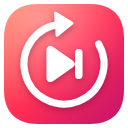

<p align="center">
  
</p>

# AutoSkip: Auto Skip for YouTube & YouTube Music

A small, open-source browser extension that **presses YouTube's "Skip Ad" button for you** as soon as it appears, on both YouTube and YouTube Music.

Works on **Firefox** and on **Chromium-based browsers** (Chrome, Edge, Brave, Opera, …).

## Why?

If you play music or videos in the background, a skippable ad can sit there waiting for you to come back and click **Skip**. AutoSkip clicks it for you, so playback just continues.

AutoSkip is **not an ad blocker**. Ads still load and play normally; the extension only presses the Skip button YouTube already gives you. If you want to support creators, you can set a delay so the ad plays a little longer before it's skipped.

## Features

- **Automatic skipping** as soon as the Skip button shows up
- **YouTube and YouTube Music** support
- **Skip delay**: wait from 0 to 3 seconds before skipping
- **Optional notification**: a small "Ad skipped" message over the video
- **On/off switch** in the extension popup
- **No data collection**: no account, no tracking, no analytics

## Settings

Click the AutoSkip icon in your browser toolbar to open the settings:

| Setting | What it does |
| --- | --- |
| **Enable auto-skip** | Turns automatic skipping on or off. |
| **Show notifications** | Shows a short "Ad skipped" message over the video. Off by default. |
| **Skip delay** | How long to wait after the Skip button appears (Instant to 3s). |

Changes apply immediately. There's no need to reload YouTube.

## How it works (simple version)

1. **It watches the page.** While you're on YouTube, AutoSkip keeps an eye out for the Skip Ad button.
2. **It waits, if you asked it to.** When the button appears, it waits for your chosen delay.
3. **It presses Skip.** YouTube ignores ordinary "fake" clicks made by extensions, so AutoSkip instead asks YouTube's own Skip button code to run, exactly as if you had clicked it yourself.
4. **Playback continues.** YouTube skips the ad in its normal way.

```text
Ad starts → Skip button appears → (optional delay) → AutoSkip presses Skip → video continues
```

### A bit more detail

The extension has two small parts that run on YouTube pages:

- **The watcher** (`content.js`) reads your settings, spots the Skip button and decides *when* to skip.
- **The helper** (`youtube-bridge.js`) runs inside the YouTube page itself. When the watcher says "skip now", it triggers YouTube's own click handling for the Skip button.

They are separate because browsers keep extension code and website code apart for safety. Only the watcher can read your settings, and only the helper can reach YouTube's button code. The watcher sends the helper a simple "skip now" signal and nothing else.

The same code runs in both Firefox and Chromium browsers. No special browser permissions are needed beyond saving your settings.

## Permissions

| Permission | Why |
| --- | --- |
| `storage` | To remember your settings (on/off, notifications, delay). |

The extension only runs on `youtube.com` and `music.youtube.com`.

## Privacy

AutoSkip doesn't collect, store or send anything about you: not your history, the videos you watch, or the ads you see. Your three settings are saved in your browser's own extension storage and synced by your browser if you have sync turned on.

## Installation

### Chrome, Edge, Brave and other Chromium browsers

1. Download or clone this repository.
2. Open `chrome://extensions` (or `edge://extensions`, `brave://extensions`, …).
3. Turn on **Developer mode** (top-right).
4. Click **Load unpacked** and choose the folder that contains `manifest.json`.
5. Open YouTube. You're done.

### Firefox

Firefox only permanently installs extensions that Mozilla has signed.

**To try it out (until Firefox restarts):**

1. Download or clone this repository.
2. Open `about:debugging#/runtime/this-firefox`.
3. Click **Load Temporary Add-on…** and choose `manifest.json`.

**To keep it installed:** use a signed `.xpi` build of AutoSkip. Alternatively, in Firefox Developer Edition, Nightly or ESR, you can set `xpinstall.signatures.required` to `false` in `about:config` and install the zip from `about:addons` → ⚙ → **Install Add-on From File…**.

Requires Firefox 128 or newer, or Chrome 111 or newer.

## Troubleshooting

- **Nothing happens:** make sure **Enable auto-skip** is on, then reload the YouTube tab.
- **No notification:** turn on **Show notifications** in the popup.
- **It stopped working after a YouTube update:** YouTube sometimes changes its player. Please [open an issue](https://github.com/sakel4/AutoSkip/issues) with your browser and version.

## For developers

After changing the code, reload the extension (`chrome://extensions` → **Reload**, or **Reload** in `about:debugging` on Firefox), then reload any open YouTube tabs.

| File | Purpose |
| --- | --- |
| `manifest.json` | Extension definition for both browsers. |
| `content.js` | Settings, Skip button detection, delay, retries and notification. |
| `youtube-bridge.js` | Runs inside the YouTube page and triggers the Skip button's click handling. |
| `popup.html` / `popup.css` / `popup.js` | The settings popup. |

Contributions, bug reports and ideas are welcome on [GitHub](https://github.com/sakel4/AutoSkip).

## License

GNU General Public License v3.0. See [`license.txt`](license.txt).

## Disclaimer

AutoSkip is an independent project and is not affiliated with, endorsed by, or associated with YouTube or Google. YouTube and YouTube Music are trademarks of their respective owners.

Created by [Sakellaris Sfakiotakis](https://links.sakel.dev).

## Support the project

AutoSkip is free and always will be. If it saves you a few trips back to your computer and you'd like to say thanks, you can buy me a coffee on Ko-fi:

[](https://ko-fi.com/sakel4)

Donations are completely optional. Starring the repository, reporting bugs and sharing the extension help just as much.
